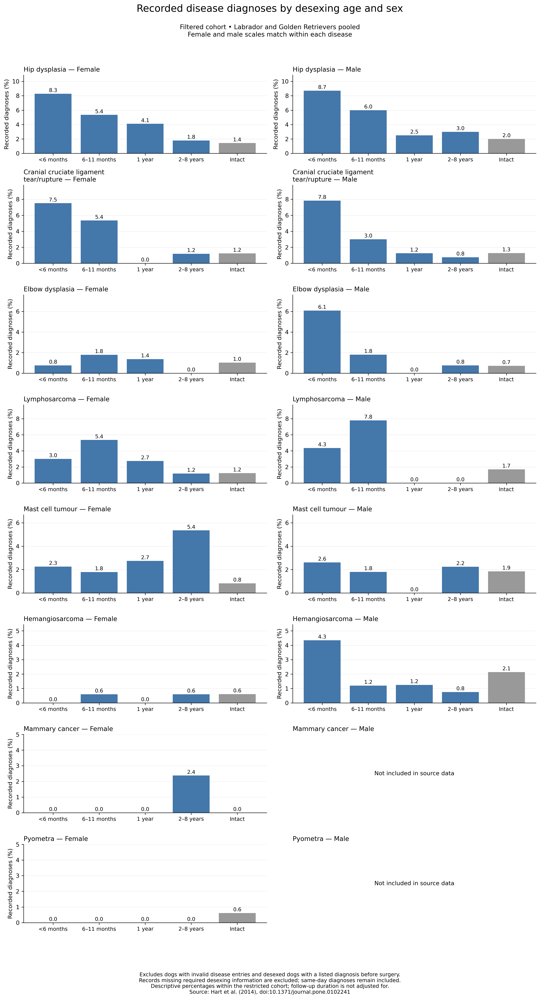

# Retriever health and desexing

An exploratory SQL and Python project investigating recorded disease occurrence across desexing-age categories in Labrador and Golden Retrievers.

## Project at a glance

- **Source:** four published veterinary-record PDF tables, covering 2,514 dogs.
- **Workflow:** PDF tables → Python extraction and checks → PostgreSQL cleaning and aggregation → Python charts and chi-square test.
- **Final cohort:** 2,227 dogs after documented exclusions.
- **Skills demonstrated:** PDF extraction, schema mapping, validation, SQL views, conditional aggregation, window functions, lateral queries, visualisation and statistical interpretation.

## Research question

How does the proportion of dogs with selected recorded diseases vary across desexing-age categories and intact dogs in this dataset?

## Findings

| Desexing category | Recorded disease | No recorded disease | Dogs | Recorded disease (%) |
|---|---:|---:|---:|---:|
| Under 6 months | 60 | 188 | 248 | 24.19 |
| 6–11 months | 65 | 270 | 335 | 19.40 |
| 1 year (12–23 months) | 12 | 141 | 153 | 7.84 |
| 2–8 years | 28 | 274 | 302 | 9.27 |
| Intact | 100 | 1,089 | 1,189 | 8.41 |

An exploratory chi-square test found an overall association between category and any recorded disease: **χ²(4, N = 2,227) = 71.94; p ≈ 8.82 × 10⁻¹⁵**. All expected cell counts exceeded five. The test does not identify which pairs differ or establish causation.

See [results.ipynb](results.ipynb) for the executed analysis and individual disease charts.



## Data preparation and decisions

The original groups comprise 471 female and 543 male Golden Retrievers, and 692 female and 808 male Labradors. Source PDFs are preserved; filename and page references are carried into the consolidated CSV.

1. Extract tables, verify page headings and sex labels, and check identifiers and group counts.
2. Preserve source fields as text in `dogs_raw`.
3. Standardise equivalent category labels in `dogs_clean`. A single `2 - 4 yr.` entry (LR179xy) was checked against its dates and mapped to `2 - 8 yr.`; the dog was desexed at two years.
4. Record eligibility in `dogs_eligibility`, retaining the reason for exclusion.
5. Use `dogs_analysis` for every final disease calculation.

### Exclusions

- 252 dogs had at least one `invalid` disease entry.
- 37 desexed dogs had a listed diagnosis before surgery.
- Two dogs met both conditions: **287 distinct exclusions**, leaving **2,227**.
- Missing/unrecognised categories and missing surgery dates in desexed dogs are also screened; these add no exclusions in the current data.

The exclusive SQL audit reports 37 pre-surgery exclusions and 250 invalid-entry exclusions because it assigns the first matching reason. The overlapping counts above explain why they differ.

According to the dataset key, `invalid` means onset outside the study range or insufficient diagnostic confirmation. It must not be counted as a diagnosis. Blank fields mean no recorded diagnosis, not proven absence of disease. Same-day diagnosis and surgery remain included because the event order is unknown.

This project's rule excludes an entire dog if any listed disease is invalid or precedes surgery. It differs from the source study's disease-specific assignment of pre-surgery diagnoses to intact exposure. Individual-disease charts use this same restricted cohort. MC and PYO were included only in the female source tables.

## Reproduce the workflow

### Requirements

PostgreSQL 18, pgAdmin (or another SQL client), and a Python/Jupyter environment. Install the Python packages in your environment:

```bash
python -m pip install pandas pdfplumber matplotlib scipy jupyter ipykernel
```

### Run order

1. Obtain the four retriever data PDFs and `Dataset Key.pdf` from the dataset source below, retaining their original filenames in `dataset/`.
2. From the project root, run all cells in [consolidate_retriever_health_data.ipynb](consolidate_retriever_health_data.ipynb). It produces `dataset/csv/dogs_combined.csv`.
3. Create a PostgreSQL database named `lab_desex`. Run section 1 of [retriever_desex.sql](retriever_desex.sql) through the `CREATE TABLE` statement.
4. Import `dogs_combined.csv` into `public.dogs_raw`: CSV, UTF8, header enabled, columns in the declared order. Import once: another import appends duplicate rows.
5. Run the SQL script with the populated table. The views are defined before the analyses, and audit queries expose cohort counts and exclusions.
6. Run section **5b** separately and export its result with headers to `dataset/csv/disease_percentages_by_sex_filtered.csv`.
7. Run section **5c** separately and export its result with headers to `dataset/csv/disease_counts_by_desexing_group_filtered.csv`.
8. Restart the kernel and run all cells in [results.ipynb](results.ipynb), then save. It reads these CSVs, not the live database, and regenerates the filtered figure.

For a quick review, the supplied filtered CSVs let you run `results.ipynb` without setting up PostgreSQL.

## File guide

| File | Purpose |
|---|---|
| `consolidate_retriever_health_data.ipynb` | Extract and validate source PDF tables |
| `retriever_desex.sql` | Raw schema, cleaning views, audits and final export queries |
| `results.ipynb` | Executed descriptive results, charts and exploratory test |
| `dataset/csv/dogs_combined.csv` | Consolidated source records |
| `dataset/csv/*_filtered.csv` | Final aggregated inputs used by the results notebook |
| `outputs/figures/disease_by_desexing_age_and_sex_filtered.png` | Final disease chart |

Other page-level CSVs and male-only exports are intermediate files. Earlier unfiltered disease exports and the unfiltered chart are superseded: their initial nonblank-field rule incorrectly counted `invalid` entries. They are not the project's final findings.

## Limitations

- Observation duration and age at last follow-up are not adjusted; longer observation provides more opportunity for diagnosis.
- Requiring desexed dogs to have no listed disease before surgery creates selection differences, especially for later surgery. Intact dogs have no equivalent surgery checkpoint.
- Breeds are pooled. Sex and breed composition can influence the combined comparison.
- The combined outcome mixes different diseases and includes female-only source fields.
- Retrospective hospital records are not a random population sample. Missing records and referral patterns can affect comparisons.
- Charts are descriptive; no disease-specific tests, pairwise tests or confidence intervals are reported.

The defensible conclusion is an association within the restricted sample, not evidence that desexing caused disease. Survival analysis with disease-specific exposure timing and breed/sex comparisons is a possible extension, outside the present scope.

## Sources

Hart, B. L., Hart, L. A., Thigpen, A. P., & Willits, N. H. (2014). *Long-Term Health Effects of Neutering Dogs: Comparison of Labrador Retrievers with Golden Retrievers*. PLOS ONE, 9(7), e102241.

- [Research paper](https://doi.org/10.1371/journal.pone.0102241)
- [Published dataset](https://doi.org/10.6084/m9.figshare.1038819)
- Local definitions: `dataset/Dataset Key.pdf`

The underlying data belong to their original creators; this repository presents a separate exploratory analysis.
